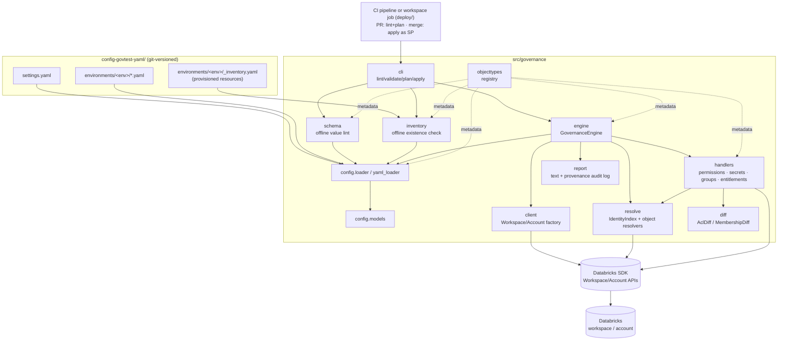
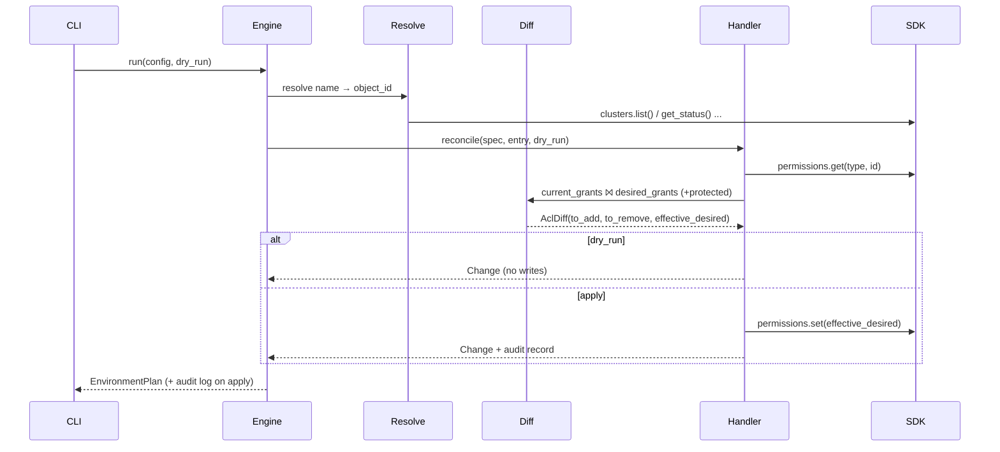

# Databricks Governance Framework — Design

**Status:** Part 1 (Workspace Object Governance) implemented. Part 2 (Unity Catalog) planned.
**Audience:** engineers building on, operating, or reviewing this framework.

---

## 1. Purpose & goals

Manage Databricks access control as **code**:

- **Configuration-driven** — governance rules are declarative JSON (or YAML) stored in git
  and code-reviewed like any other change.
- **Version-controlled** — every change to who-can-access-what is a commit with history.
- **Reconciled on deployment** — a CLI uses the **Databricks Python SDK** to make the live
  workspace/account match the config. Lower environments apply locally; higher environments
  apply only through CI as a service principal (section 6.1).
- **Drift-removing** — the config is the single source of truth: access present in the
  workspace but absent from config is revoked.
- **Validated before it runs** — structural, value, and (with an inventory) existence checks
  run offline in CI, before any workspace is touched (section 4.6).
- **Auditable & safe** — dry-run previews, protected principals, owner/admin retention,
  confirmation prompts, and provenance-stamped JSON audit logs.

The framework has two parts:

1. **Workspace object governance (ACLs)** — *this implementation*. Permissions on
   compute, workflows, code, ML assets, secrets, tokens, plus **group membership**.
2. **Data & AI governance (Unity Catalog)** — *planned*. Catalog/schema/table/volume/
   function grants and UC-registered models via `GRANT`/`REVOKE`.

### Non-goals (Part 1)

- Unity Catalog grants (Part 2).
- Provisioning users/service principals — identities come from the IdP/SCIM sync. The
  framework references them; it never creates them.
- Assigning account identities to a workspace (workspace assignment / identity federation
  is an account-admin action). The framework can *report* an unassigned group offline
  (section 4.6) but does not perform the assignment.
- Cloud IAM, network, or workspace-level settings outside object ACLs.

The framework governs **group membership only when you want it to** — see the two
ownership models in section 4.3.1. In the IdP-groups model it manages nothing but permissions.

---

## 2. Key design decisions

| Decision | Choice | Rationale |
|---|---|---|
| Config format | **JSON** (default) or **YAML** (opt-in) | JSON parses with zero dependencies (stdlib); YAML via a separate loader (`--format yaml`, needs PyYAML). Same schema/validation either way. |
| Config values | **Constrained, not free-form** | Permission levels are per-type enums; principals are format-checked (email / UUID). Enables an offline CI lint gate. |
| Runtime deps | **`databricks-sdk` + stdlib only** (PyYAML optional) | Runs in locked-down/offline governance environments with no extra installs; the YAML path is the one exception, and opt-in. |
| Enforcement mode | **Full reconcile (drift removal)** | Guarantees the live state equals the reviewed config. |
| Reconcile primitive | `permissions.set()` | The Permissions API `set()` **replaces** all direct ACLs — native drift removal. `update()` (additive) is intentionally unused. |
| Principals | groups **and** users **and** service principals | Maximum flexibility; groups are strongly encouraged (see section 4.3.1). |
| Execution | **Two modes per environment** | Lower/test envs apply locally via a profile; higher envs are CI-only (`require_ci`), applied by a service principal. Same binary, same commands (section 6.1). |
| Offline existence check | **Optional inventory manifest** | `_inventory.yaml` per env lets `lint` verify objects/principals exist — and flag account groups not assigned to the workspace — with no credentials (section 4.6). |
| Group lifecycle | **create + membership + delete**, deletion behind a switch | Full control when the framework owns groups; omitted entirely in the IdP-groups model. |
| Identity scope | **workspace or account** (per environment) | Both `WorkspaceClient` and `AccountClient` expose identical SCIM APIs, so one code path serves both. || CLI/validation/output | argparse + dataclasses + plain text | No `typer`/`pydantic`/`rich` needed; portable. |

---

## 3. Architecture

### 3.1 Component overview



### 3.2 Module responsibilities

| Module | Responsibility |
|---|---|
| `objecttypes.py` | Registry of governed types (`ObjectTypeSpec`): key, `kind`, id field, API type, and **allowed permission levels** (static enum per type). Pure metadata, no SDK calls. Defines canonical processing order (groups first). |
| `config/models.py` | Dataclasses `AclEntry`, `ObjectEntry`, `MemberEntry`, `GroupEntry` with `from_dict` validation. |
| `config/loader.py` | Reads/merges/validates JSON; `Settings` / `EnvironmentSettings` / `AccountSettings`. |
| `config/yaml_loader.py` | YAML parse step (PyYAML) feeding the same models and validation as `loader.py`. |
| `errors.py` | `GovernanceError`, `ConfigError`, `ResolutionError`. |
| `client.py` | `make_client()` → `WorkspaceClient`; `make_account_client()` → `AccountClient`. |
| `resolve.py` | `IdentityIndex` (cached SCIM lookups; principal validation; member→SCIM-id); object resolvers (`name`/`path` → `request_object_id`). |
| `diff.py` | Pure set logic: `AclDiff` (grants) and `MembershipDiff` (members); SDK-model normalizers. |
| `handlers/permissions.py` | Reconcile object + token ACLs via Permissions API. |
| `handlers/secrets.py` | Reconcile secret-scope ACLs via Secrets API. |
| `handlers/groups.py` | Group create/membership/delete via SCIM. |
| `handlers/entitlements.py` | Entitlements reconcile via workspace SCIM (principals must already be in the workspace). |
| `schema.py` | **Offline** value linting: permission enums + principal/identifier formats. No SDK calls. |
| `changes.py` | `Change` / `EnvironmentPlan` result types shared by plan & apply. |
| `engine.py` | `GovernanceEngine`: wiring, ordering, validate/plan/apply. |
| `report.py` | Plain-text rendering + timestamped JSON audit log. |
| `cli.py` | `argparse` entrypoint; exit codes; confirmation; deletion overrides. |

### 3.3 Object-type registry

Every governed type is one `ObjectTypeSpec`:

| `kind` | Types | API used | Identifier |
|---|---|---|---|
| `groups` | `groups` | SCIM (`groups`/`users`/`service_principals`) | `name` (display name) |
| `entitlements` | `entitlements` | Workspace SCIM (`groups`/`users`/`service_principals`) | principal (`group`/`user`/`service_principal`) |
| `permissions` | `clusters`, `cluster-policies`, `instance-pools`, `warehouses`, `jobs`, `pipelines`, `notebooks`, `directories`, `repos`, `experiments`, `serving-endpoints`, `dashboards`, `queries`, `alerts` | Permissions API | `name` or `path` |
| `secrets` | `secret-scopes` | Secrets API | `name` (scope) |
| `tokens` | `tokens` | Permissions API on `authorization/tokens` | singleton |

> **ML note:** MLflow experiments and serving endpoints are ACL-governed and live here.
> **UC-registered models** are governed by `GRANT`s and belong to Part 2.

Each spec also carries its **allowed permission levels** (`allowed_permissions`), the enum
the offline linter checks config values against. See
[config-schema.md](config-schema.md) for the full matrix.

---

## 4. Reconcile semantics

### 4.1 Full reconcile with drift removal

For a Permissions-API object, reconcile is:

```
current  = direct, non-owner grants from permissions.get()
desired  = grants from config
effective_desired = desired ∪ {current grants whose principal is protected}
apply: permissions.set(effective_desired)   # replaces all direct ACLs
```

- `set()` deletes any direct permission not included → **drift removal**.
- **Owners (`IS_OWNER`) and workspace admins are always retained by the platform**, so
  the framework never manages them (they are filtered out of `current`).
- **`protected_principals`** — their current grants are folded into `effective_desired`,
  so they are never revoked (useful for break-glass admins/service principals).

Secret scopes use the same idea per principal (`put_acl` for add/change, `delete_acl`
for removal); tokens use the Permissions API on the singleton `authorization/tokens`.

### 4.2 Grant model

A grant is a `(principal_type, principal_name, permission_level)` triple. Because `set()`
replaces wholesale, a level change is expressed as one removed grant + one added grant.
Inherited permissions are ignored (only *direct* grants are managed).

### 4.3 Group governance

Applied in a **safe order** so nested-group references resolve:

1. **Create** groups in config but missing in the workspace/account.
2. **Membership** reconcile — add/remove members so each group matches config
   (drift removal: unlisted members are removed). Members resolve to SCIM ids.
3. **Delete** groups not in config — only when the deletion switch is on, and **never**
   built-in (`admins`, `users`, `account users`) or `protected_principals` groups.

**Scope:** `group_scope` per environment selects the SCIM client — `workspace`
(`WorkspaceClient`) or `account` (`AccountClient`). Object ACLs/secrets/tokens are always
workspace-scoped; only group membership can target the account. The same `IdentityIndex`
and `GroupHandler` serve both because the SCIM APIs are identical in shape.

### 4.3.2 Entitlements

Each `entitlements` entry is one principal's complete entitlement set. `apply` adds
missing entitlements and removes extra ones through workspace SCIM, never removing from
`admins` or `protected_principals`. The principal must already be in the workspace;
otherwise the entry fails with a resolution error.

### 4.4 Processing order

The engine iterates types in registry order — **`groups` first**, then `entitlements` —
so that groups referenced by object ACLs exist before those ACLs are applied.

### 4.5 Reconcile sequence (one permission object)



---

## 4.6 Validation layers

Validation happens in three progressively-deeper layers:

| Layer | Where | Network | Checks |
|---|---|---|---|
| **Structural** | `config/loader.py` (+ `yaml_loader.py`) | none | YAML/JSON well-formed; known keys/types; exactly-one-principal; id-field rules; duplicates |
| **Value (lint)** | `schema.py` → `governance lint` | none | permission ∈ per-type enum; principal formats (email / UUID); clean identifiers; no free-form text |
| **Live (validate)** | `engine.py` → `governance validate` | live workspace | objects exist; principals/members exist; permission levels valid per the workspace |

The first two run in CI on every commit; the third runs against the target workspace
before `apply`.

## 5. Configuration model

### 5.1 Layout

```
config-govtest-yaml/
├── settings.yaml               # environments → auth; account; switches
├── templates/                  # one template per config set (see config-schema.md)
└── environments/
    └── <env>/*.yaml             # merged by top-level object-type key
```

Templates for each set (settings, identity, compute, jobs, ml-assets, secrets, sql-bi,
workspace) live in `config-govtest-yaml/templates/`; allowed values and formats are in
[config-schema.md](config-schema.md). The CLI reads this tree with
`--config config-govtest-yaml --format yaml`; the same structure in JSON
(`settings.json`, `*.json`) is also accepted.

Files under an environment are merged by their top-level key, so organization is free
(e.g. `compute.yaml` may hold both `clusters` and `warehouses`). A key may appear once
across an environment's files. Files starting with `_` (e.g. `_inventory.yaml`) are not
merged.

### 5.2 `settings.yaml`

```yaml
environments:
  dev:
    profile: dev
    group_scope: workspace
  prod:
    profile: prod
    group_scope: account
account:
  profile: account-admin
  account_id: "..."
protected_principals: [admins, account-admins]
allow_group_deletion: false
```

- **`environments.<env>.profile|host`** — SDK auth (profile preferred; host uses env/OAuth).
- **`environments.<env>.group_scope`** — `workspace` (default) or `account`.
- **`account`** — required if any environment uses `group_scope: account`.
- **`protected_principals`** — never revoked/deleted (beyond owner/admins).
- **`allow_group_deletion`** — master switch for the group delete phase (default `false`).

### 5.3 Object ACL entry

```yaml
jobs:
  - name: daily-etl
    acls:
      - {group: data-engineers, permission: CAN_MANAGE}
      - {user: analyst@corp.com, permission: CAN_VIEW}
      - {service_principal: "<sp-application-uuid>", permission: CAN_MANAGE_RUN}
```

- Identify by `name` (compute/jobs/experiments/serving-endpoints) or `path`
  (notebooks/directories/repos).
- Each ACL entry sets **exactly one** of `group`/`user`/`service_principal` + a `permission`.
- Permission levels are validated per object type at `validate` time via
  `permissions.get_permission_levels`; secrets use `READ`/`WRITE`/`MANAGE`.
- `tokens` is a singleton (no identifier).

### 5.4 Group entry

```yaml
groups:
  - name: data-engineers
    members:
      - user: alice@corp.com
      - service_principal: "<sp-application-uuid>"
      - group: etl-oncall
```

### 5.5 Entitlement entry

```yaml
entitlements:
  - group: business-analysts          # must already be in the workspace
    entitlements: [workspace-consume]
```

One principal per entry, with its complete entitlement set (section 4.3.2).

Members are users, service principals, or nested groups (exactly one field each).

---

## 6. CLI & outputs

| Command | Effect |
|---|---|
| `governance lint [--env E]` | **Offline** value validation (no workspace): permission enums + principal/identifier formats. Lints all environments if `--env` omitted. |
| `governance validate --env E` | Resolve objects, check permission levels, confirm principals/members exist (live workspace). No changes. |
| `governance plan --env E [--type T]` | Dry-run diff. |
| `governance apply --env E [--type T] [--yes]` | Reconcile (confirmation unless `--yes`); writes audit log. |

- `--type` limits to object type(s) (repeatable or comma-separated).
- `--delete-groups` / `--no-delete-groups` override `allow_group_deletion` for one run.
- **Exit codes:** `0` success/no-changes · `2` (plan) drift detected · `1` error / validation issues.
- **Audit log:** `audit-logs/<env>-<UTCtimestamp>.audit.json` (or `--audit-dir`) — every applied action.
- **Config location:** `--config <dir> --format json|yaml` (defaults `config`, `json`; this
  repo uses `--config config-govtest-yaml --format yaml`).

---

## 7. Safety model

- **Preview → confirm → apply** (typed `yes`, unless `--yes`; refuses to apply without
  confirmation in non-interactive shells).
- **Owner/admin retention** by the platform on every `set()`.
- **Protected principals** never revoked/deleted.
- **Destructive defaults off** — group deletion is opt-in; built-ins always protected.
- **No secrets in git** — `.databrickscfg`/`.env` git-ignored; auth is out-of-band.
- **Audit trail** — timestamped JSON of applied changes.

---

## 8. Extending the framework

**Add a new ACL-governed object type:**
1. Add an `ObjectTypeSpec` to `objecttypes.py` (`kind="permissions"`, correct `api_type`,
   `id_field`, and `allowed_permissions` — the enum the linter enforces).
2. Add a resolver `name/path → request_object_id` in `resolve.py` (`_RESOLVERS`).
3. Add a template entry in `config-govtest-yaml/templates/`, sample config, and a test. No
   handler/engine/schema changes needed — the generic `PermissionsHandler` handles all
   `permissions`-kind types and the linter reads `allowed_permissions` from the registry.

**Add a new API family (e.g. Unity Catalog / Part 2):**
1. New `kind` + specs in the registry.
2. A new handler exposing `reconcile(spec, entry, dry_run) -> (Change, audit)`.
3. Wire it into `engine.run`/`engine.validate` by `kind`.
4. Reuse `changes.py`, `report.py`, and the CLI unchanged.

---

## 9. Part 2 roadmap — Unity Catalog

- New config tree for `catalogs`, `schemas`, `tables`, `volumes`, `functions`,
  `registered-models`, `external-locations`.
- Reconcile via `WorkspaceClient.grants` (`GRANT`/`REVOKE`), diffing effective privileges.
- Same engine/report/CLI patterns; likely a `grants` kind and a `GrantsHandler`.
- Consideration: securable hierarchy and inheritance vs. explicit grants per securable.
